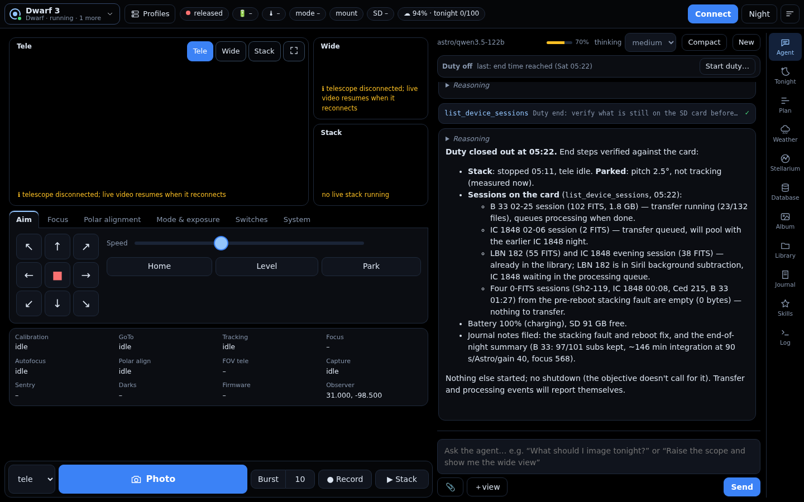
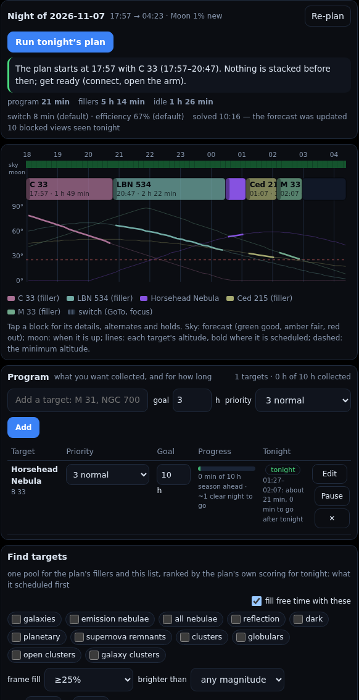
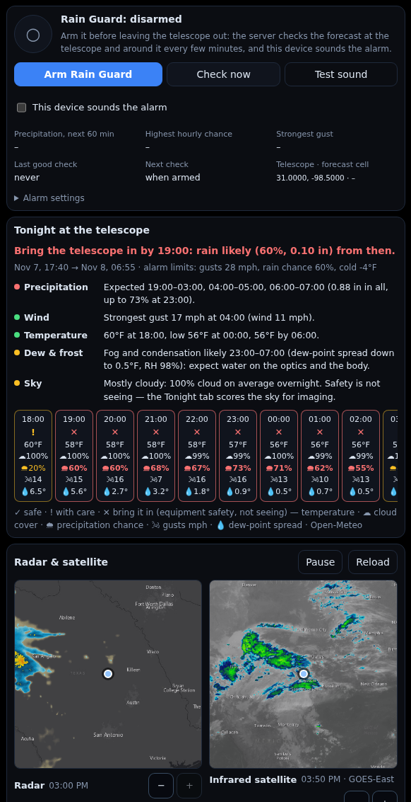
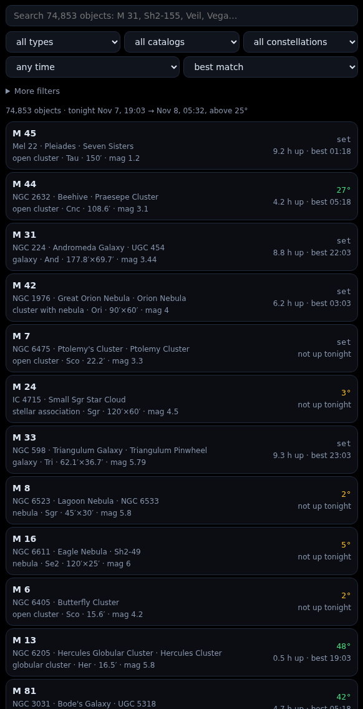
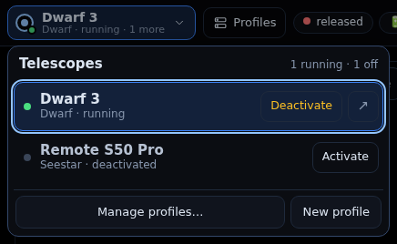
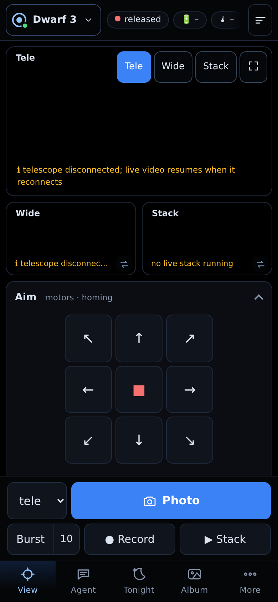
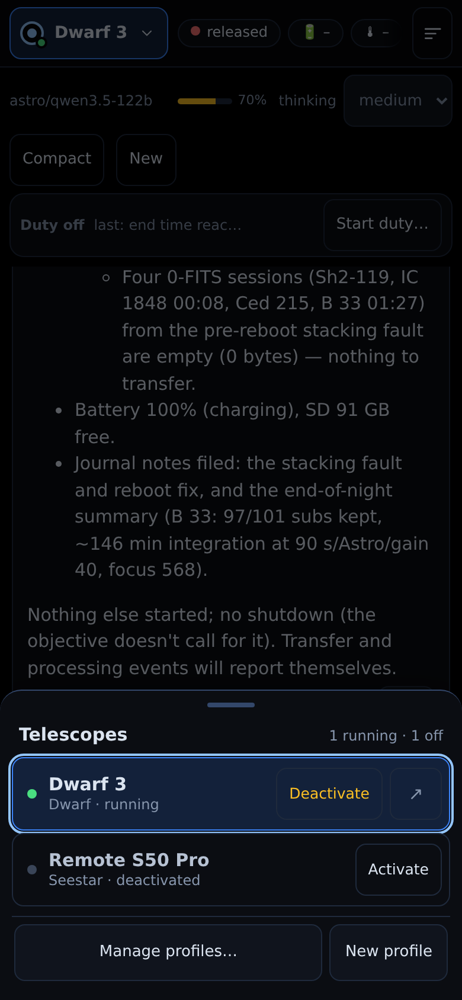

# Astrocontroller

An agentic harness for smart telescope operation and planning.

Astrocontroller puts a large language model on duty at your telescope. The model does not drive the mount or guess at exposures by itself: it is given a set of **deterministic tools** (an MCP server that controls the scope, measures frames, solves the night, reads the forecast and manages the data) and a web UI you share with it. You tell it what you want collected and how much it matters, and it runs the night: it points, focuses, stacks, watches the subs, reacts when something goes wrong, moves the data off the scope and hands it to processing. You can chat with it at any time, or ignore it and drive the scope by hand from the same page.

> **A hobby project inside a hobby.** I made this for myself, for the telescopes I own, and I am sharing it in case anyone wants to use it, build on it, or contribute. The vast majority of the code was written with AI assistance. It is not production software: there are rough edges, things that have only been exercised on my hardware, and parts that have never seen a clear sky. Technical knowledge is required to set it up and run it (Docker, `.env` files, a network you understand, and a vision-capable LLM you can point it at). If that sounds like you, welcome.
>
> **Firmware updates may break this.** Everything here talks to the telescopes over protocols that DWARFLAB and ZWO do not document or promise to keep stable, and a future firmware or app update may change them. I will do what I can to keep it updated for the devices I own, but expect occasional breakage after an update and check the issues before upgrading your scope mid-season.

## Why bring an agent to the telescope?

The vendor apps (DWARFLAB, Seestar) are good at one thing: run the session you tapped in. If clouds roll over the target, the stacker rejects frames until you notice. If focus drifts with the temperature, the stack softens until you notice. If the night plan you set at dusk stops making sense at 1 am, it carries on anyway. Sequencers like NINA are far more powerful, but they are still scripts: every contingency you did not write down is a contingency nothing handles, and they do not run on a smart telescope in the first place.

An agent sits in the gap between those two. It can **look** (at the live view, at the subs, at a plate solve, at the forecast), it can **reason** about what it sees against the plan, and it can **act** with the tools it has been given. What Astrocontroller adds around the model is the part that makes this trustworthy enough to leave running while you sleep:

- **Deterministic tools do the measuring.** Star sharpness, sub analysis, the night solver, the exposure planner, the sub-length calculator, the cloud and obstruction checks are all plain code with tests. The model decides *what to do*; the numbers it decides on are not hallucinated.
- **A duty loop keeps it awake.** An LLM turn ends when the model stops calling tools. The duty loop wakes the agent on a schedule it picks (30 s to 15 min) and immediately on events: a stack that stopped, a transfer that finished, a link drop, low battery, a stack that is rejecting every frame. It never gets to "sleep" and forget the scope.
- **Procedures, not vibes.** The agent's system prompt is written as numbered procedures for every situation it meets (no stack running, every new target, obscured, stack collecting, target change, dawn), with the exact tools to call. Skills add the detail. Your instructions override everything.
- **It learns in the open.** The agent keeps its playbooks (skills) and operating notes as files you can read and edit in the UI, and it is told to refine them as it learns what works on your rig and your site.

### What it does on duty

While the agent is on duty it samples the scope on its own schedule and reacts to what would affect the plan:

- **Target obscured by cloud or a tree.** It checks visibility after every GoTo. If the target is blocked it files the patch of sky (not the target) with the planner, which re-solves the rest of the night and hands back an alternate in a different quadrant of the sky. The original target comes back on its own when its path clears the obstruction or the cloud hold runs out.
- **Focus drifts.** It analyzes recent subs (star count, half-flux radius, roundness) every sample. When the planner says a refocus is due or the stars have grown, it stops the stack, re-runs the focus procedure (autofocus, then a sharpness sweep that lands on the measured best position) and resumes stacking.
- **Rejections start.** A stack supervisor watches the kept/rejected ratio and wakes the agent the moment a stack is collecting nothing. The agent looks at the frames and the sky and acts: cloud is a hold and an alternate, trailing or overexposure is a shorter sub or lower gain, a lost target is a new GoTo.
- **The plan moves on.** When the solver's next block starts, it stops, slews, re-runs the full target procedure on the new target, and only then transfers the previous target's session so processing can start while the scope is still working (on autonomous Starfront nights, everything waits until the roof closes).
- **Housekeeping happens when it is free.** Forecast checks, notes, dark inventories and session logs happen only while a stack is collecting. If nothing is collecting, getting a stack running is the only job.
- **Dawn or the end time.** It stops, parks, transfers everything still on the card, confirms processing is queued, and writes the night up in the journal.

You can talk to it the whole time. A message during its turn steers it at the next step, a queued message waits for the turn to end, and you can always take the controls yourself.

## Maximizing what you collect

The planning side is where the maths lives. The goal is to turn a list of things you want into the most useful integration a given night can produce, and to keep re-solving as the night changes.

**Your program.** You add targets with an integration goal (hours), a priority (1 to 5), and optionally a filter, a minimum altitude, a "not before" date, "keep collecting after the goal", and a note for the agent. **Find targets** filters the whole catalog (about 75,000 merged objects) by type, frame fill, magnitude and size, and the same filter picks the plan's **fillers**: what to shoot in the hours none of your own targets can use. The fillers are drawn to cover every hour of the night in every quadrant of the sky, so there is something to shoot, and an alternate in another direction when cloud or an obstruction takes one out. A filler you have already started is finished (up to the integration goal in the target memory, or a goal suited to the object when none is set) before a new one begins. You decide what counts as a filler, so the scope is never idle on a clear night but never wastes dark time on things you do not want.

**The night solver.** Every night is solved from astronomical dusk to dawn as a dispatch schedule over 10-minute slots. A target's merit in a slot is the product of its altitude above the plan's minimum, its own, and the site's obstruction map (weighted by airmass); field rotation near the zenith on an alt-az mount; Moon avoidance (a Lorentzian whose width depends on phase and filter) and what moonlight leaves of the target through that filter; and the forecast (cloud hours are not scheduled, poor seeing costs galaxies and planetaries most, poor transparency costs broadband most). Targets are valued by priority, by how far they are from their goal, and by how fast their **season** is closing (usable time over the next 90 nights against what they still need), so the target about to be lost for the year beats the one that will still be there in March. A switch costs the measured **overhead** (GoTo, centring, focus) and only a share of stacking time becomes integration (the **efficiency**); both are learned from your journal, not assumed.

**Re-solved all night.** The rest of the night is solved again when the forecast updates, a session ends, a hold is set or runs out, the program or settings change, and every half hour. The target being worked is locked to the end of its block, so a re-solve plans around it: only an obscured or sky hold on it, a skip, a pin, its goal or its leaving the sky ends that early. The past is kept as it was. Every block carries alternates in other quadrants of the sky, and every duty sample carries the plan's line: what to do now, whether the scope is on plan, holds, a refocus that is due, a stack that is rejecting.

**The exposure planner.** For each target `acquisition_plan` scores every filter, gain and sub length the device offers across the target's window with the CCD equation per Bayer cell: the target's electrons through the filter, the sky's (your zenith sky brightened by airmass and scattered moonlight, with extinction from the forecast's transparency), dark current and read noise, the per-sub overhead and dither cost, and the share of subs the stacker keeps at that sub length (learned from the journal). Candidates that trail (alt-az field rotation from the actual pointing, unguided-EQ drift, wind), that overexpose the sky or clip the target's core, or that have no dark master are removed. It tells you what bound the answer and where every number came from.

**Measured, not guessed.** `acquisition_measure` turns your rig's own raw frames into the numbers the spec sheet can only approximate: read noise, offset and dark current from darks; gain in e⁻/ADU, clip level, sky brightness in mag/arcsec², star FWHM and the real dither cost from light subs. Three good sky cohorts replace your Bortle guess with a measured sky. `sub_length` is a deterministic port of Deep Sky Detail's Sub Length Calculator run on one of your own subs: it reports the swamp factor (sky noise² over read noise²), the sub efficiency, the extra integration a shorter sub would cost, and the shortest offered sub that reaches your target factor. From then on the planner scales its sky model by the measured ratio at that pointing.

**A journal that feeds back.** Each target visit is recorded from the telescope's state whoever started it: time to get on target, focus positions, stack start and end, rejection bursts, kept and rejected frames, integration, efficiency, altitude, Moon, forecast, and the stack's stars, HFR and background. The solver's overhead and efficiency, the planner's keep rate per sub length, and the agent's own notes all come from here.

## What you can do with it

- **Put the agent on duty** with an objective and an end time (dawn, a time, or none), or run tonight's plan with one button.
- **Chat** with the agent: ask what last night did, have it research a target (SIMBAD, Wikipedia, a reference image framed to your field), ask it to image something, steer it mid-turn.
- **Drive the scope by hand** from the same page: live tele and wide views, a joystick pad, focus controls including a star-sharpness sweep, mode and exposure, photo, burst, timelapse, record, stack, home, level, park, polar alignment.
- **Keep a program** and let the Plan tab show you the solved night, each target's season, what tonight adds, why something is or is not scheduled, and what was held back and why.
- **See what is coming and going**: a Calendar tab ranks your program and filtered targets by which windows close or open next, with each target's integration against its goal, the time it has left, and a night-by-night heatmap of the hours clear of the Moon.
- **Research anything you see**: a **Research** button next to GoTo and the Stellarium buttons (Database, Plan, Tonight, the Stellarium card) has the agent put together a target package: what it is, its discovery and history, reference images (a survey plate framed to your field and the best published photo), when it is up tonight and through the year, and the filter, gain, sub length and integration it recommends for your telescope.
- **Browse the sky**: a Database tab over the merged catalog with altitude curves and "up tonight" filters, and a bundled Stellarium planetarium with your horizon, your frame, the night plan drawn on the sky, and GoTo from the map.
- **Decide whether the scope can stay out**: a Weather tab with an hour-by-hour safety report and a **Rain Guard** that watches the 15-minute forecast around your site and sounds an alarm on your phone.
- **Manage the data**: transfer sessions off the scope into a library laid out the way processing expects, free the card safely (only what is already copied), see every image the agent looked at.
- **Process automatically** by pairing with [AstroPhoto Studio](https://github.com/methenol/AstroPhoto-Studio), my companion processing project: each transferred session is queued, multi-night stacks of the same target, camera and filter can be pooled, and results land next to the raws.
- **Run several telescopes** from one container, each with its own agent, plan, site, library and skills.
- **Use it from a phone at the scope**: the UI is mobile-first, installable, keyboard-safe, and has a night mode.

### A look around

The live view and the controls stay on the left; the sections sit on the right, picked from the rail along the right edge.



| | |
|---|---|
|  |  |
| **Plan**: the solved night, each block over its target's altitude, the sky forecast and the Moon, and your program below. | **Weather**: the Rain Guard and an hour-by-hour report on whether the scope can stay out. |
|  |  |
| **Database**: about 75,000 objects with tonight's visibility, filterable by type, catalog, constellation and time. | **Profiles**: switch telescopes from the top bar, activate or deactivate one, or open the profile manager. |

On a phone the same page becomes one screen at a time, with a capture bar and a bottom tab bar in reach of your thumb; the telescope switcher opens as a sheet.

<p>
  
  &nbsp;
  
</p>

<sub>Taken with no telescope connected, so the live views are empty.</sub>

## What it currently supports

| | Status |
|---|---|
| **DWARFLAB Dwarf 3** (STA mode on your LAN) | Primary target. Verified on hardware: control, both cameras, motors, focus, photo/video, live stacking, album, transfers, weather and planning, the agent end to end. Plate-solve GoTo, EQ polar alignment, Sun/Moon tracking, sentry mode and the star-focus sweep are implemented from the protocol and tested against simulators; see [Validation status](#validation-status). |
| **ZWO Seestar S30 / S50 (and Pro)** on the LAN | Native JSON-RPC driver: live views, GoTo with plate solve, stacking, autofocus, focus sweep, park, album, transfers, obstruction survey, the duty loop and the agent. Verified on an S50 Pro. |
| **Seestar over ZWO Telescope Network** (a remote or hosted scope) | Through the bundled, modified [seestar-portfwd](https://github.com/Phaeilo/seestar-portfwd) tunnel, supervised so the scope's single remote session is taken on Connect, released on Disconnect, reconnected when it drops, and never left occupied. Several remote Seestars at once. |
| **Starfront Observatories** autonomous nights | For a Seestar hosted at Starfront: the roof opening wakes the agent, the night's duty starts before dark, the roof closing or dawn stops and parks it; nothing is transferred while the roof is open (Starfront asks that files wait for the morning), and the whole night is transferred once it closes, then the scope is released. Can be left on for weeks. |
| **Processing** | Optional pairing with [AstroPhoto Studio](https://github.com/methenol/AstroPhoto-Studio) over its job API, with resumable uploads or a shared library path. |
| **Planned** | DWARFLAB **Draco**, **ZWO ASIAIR**, and **NINA** as a driver for conventional rigs. I am limited to the hardware I have access to for testing, so these depend on access to the devices or on contributors who have them. |

The firmware versions each driver was last verified against are in [Validation status](#validation-status). Newer firmware may change the protocol; see the note at the top.

Device specs for the Dwarf 3, Dwarf Mini, Seestar S30, S30 Pro, S50 and S50 Pro ship in `devices/`, and you can add or correct a model by dropping a file into `<DATA_DIR>/devices/`.

## How it is put together

- **An MCP server** (TypeScript, Node 22) exposes the telescope, the cameras, focus, planning, weather, image analysis, the night solver, the journal, the library and processing as tools. Other MCP clients can use it too (`http://<host>:8080/mcp`, Streamable HTTP).
- **[Oh My Pi](https://github.com/can1357/oh-my-pi)** (`omp`, a fork of the Pi coding agent) runs headless as the agent against your own OpenAI-compatible, vision-capable LLM. Its workspace holds the agent's system prompt, skills and notes, which it updates as it goes to improve over time.
- **A web UI** served as plain HTML/CSS/JS: live views, controls, the agent chat with reasoning and tool calls streamed live, the Plan, Journal, Tonight, Weather, Database, Stellarium, Album, Library, Skills and Log tabs, and a profile hub for several telescopes.
- **Drivers** (`src/drivers/dwarf`, `src/drivers/seestar`) translate the shared tool set onto each telescope's protocol. A control a telescope cannot do is greyed out and says so.

Everything runs in Docker from one `docker-compose.yml`. The agent's data (`./data`) and your imagery library (`./library`) are bind mounts on the host.

## Requirements

- **Technical comfort.** You will edit a `.env` file, run Docker Compose, read logs, and possibly extract a key from an APK. Nothing here is a one-click install.
- **Docker** with Compose (Docker Engine on Linux, Docker Desktop on Windows and macOS).
- **A telescope on your network** (Dwarf 3 in STA mode, or a Seestar on the LAN or on ZWO Telescope Network) and outbound internet for the forecast, the catalog services and the agent's research tools.
- **A vision-capable LLM on an OpenAI-compatible chat-completions endpoint.** The agent looks at live frames, stacks and FITS subs, so vision is not optional. Any provider or local server that speaks the OpenAI API works (vLLM, llama.cpp, LM Studio, OpenRouter, OpenAI itself).
  - **Self-hosted:** a Qwen3.8-27b class general-purpose model with at least 128k of context is the recommended minimum. Smaller models lose track of the procedures over a long night.
  - **Hosted:** tested with GPT-6 Terra and Luna as well.
- **Close the official vendor app** while Astrocontroller is connected. A Dwarf drops every other control connection while the DWARFLAB app holds a session, and a Seestar serves one remote session at a time.

## Installation

Development happens on Linux. Windows and macOS use the same Docker Compose setup and are expected to work, but have had less exercise; please open an issue if something does not.

### Linux

```bash
sudo apt install docker.io docker-compose-v2 git        # or your distro's packages / Docker's own repo
sudo usermod -aG docker "$USER" && newgrp docker

git clone https://github.com/methenol/Astrocontroller.git
cd Astrocontroller
cp .env.example .env
$EDITOR .env                                             # see Configuration below
mkdir -p data library keys
docker compose up -d --build
xdg-open http://localhost:8080
```

Set `PUID` / `PGID` in `.env` to your uid and gid (`id -u`, `id -g`) so the files written to `./data` and your library belong to you. Default is 1000.

### macOS

1. Install [Docker Desktop for Mac](https://docs.docker.com/desktop/setup/install/mac-install/) (or OrbStack) and `git` (Xcode command line tools).
2. In a terminal:
   ```bash
   git clone https://github.com/methenol/Astrocontroller.git
   cd Astrocontroller
   cp .env.example .env
   open -e .env                                          # see Configuration below
   mkdir -p data library keys
   docker compose up -d --build
   open http://localhost:8080
   ```
3. `LIBRARY_PATH` can point at an external drive or a NAS mount (`/Volumes/Astro/library`); make sure that folder is shared with Docker Desktop (Settings → Resources → File sharing).
4. **Apple Silicon and ZWO Telescope Network:** the tunnel container builds with an x86-64 Android toolchain, so build it for amd64: `DOCKER_DEFAULT_PLATFORM=linux/amd64 docker compose build seestar-portfwd`, then `docker compose up -d`. If you only use a Dwarf or a Seestar on the LAN, leave `COMPOSE_PROFILES` unset and the tunnel container is never built.

### Windows

1. Install [Docker Desktop for Windows](https://docs.docker.com/desktop/setup/install/windows-install/) with the WSL 2 backend, and [Git](https://git-scm.com/download/win).
2. Clone **inside your WSL distribution** (for example Ubuntu) rather than on a Windows drive: bind mounts are much faster from the Linux filesystem and you avoid line-ending surprises in the build.
   ```bash
   git clone https://github.com/methenol/Astrocontroller.git
   cd Astrocontroller
   cp .env.example .env
   nano .env                                             # see Configuration below
   mkdir -p data library keys
   docker compose up -d --build
   ```
3. Open `http://localhost:8080` in a Windows browser. To keep the library on a Windows drive, set `LIBRARY_PATH=/mnt/d/Astro/library` (WSL path) in `.env`.
4. `PUID` / `PGID` are ignored by Docker Desktop; leave them at the default.

### Without Docker (development)

```bash
npm install && npm run build
# the agent needs Oh My Pi on the PATH: bun install -g @oh-my-pi/pi-coding-agent@<version in Dockerfile>
node --env-file=.env dist/index.js       # single telescope; needs ffmpeg. AGENT_ENABLED=false runs without omp
npm run hub                              # the multi-telescope hub
npm test
```

The web UI in `public/` is served as-is: edit and reload.

## Configuration

Everything is in `.env` (copy `.env.example`; it documents every variable). The essentials:

| Variable | Purpose |
|---|---|
| `TELESCOPE_DRIVER` | `dwarf` (default) or `seestar`. With the profile hub, each profile sets its own. |
| `DWARF_HOST` | The Dwarf's IP on your LAN (STA mode). Can also be set in the UI. |
| `SEESTAR_CONNECTION` / `SEESTAR_HOST` | `local` with the scope's IP, or `zwo` for ZWO Telescope Network (see below). |
| `OBSERVER_LATITUDE` / `OBSERVER_LONGITUDE` / `OBSERVER_ELEVATION_M` / `OBSERVER_TIMEZONE` | Your site. Needed for planning, GoTo, polar alignment and weather. |
| `UNITS` | `metric` or `imperial` for weather display and alarms. |
| `PLAN_MIN_ALTITUDE_DEG`, `PLAN_BORTLE`, `PLAN_FILTERS`, `PLAN_APERTURE_MM`, `PLAN_READ_NOISE_E`, `PLAN_MOUNT`, `PLAN_GUIDED`, `PLAN_SKY_SQM`, `PLAN_DEVICE` | What the planner judges every target against. `PLAN_BORTLE` is the one number that moves every threshold until the sky has been measured. |
| `LLM_BASE_URL` / `LLM_MODEL` / `LLM_API_KEY` | Your OpenAI-compatible endpoint. |
| `LLM_CONTEXT_WINDOW` / `LLM_MAX_TOKENS` / `REASONING_EFFORT` / `LLM_THINKING_FORMAT` / `LLM_VISION` | Model limits and request shape (`qwen` for Qwen on vLLM, `openai-responses` for OpenAI reasoning models). |
| `DUTY_INTERVAL_S` | Default time between duty samples (300). The agent can pick 30 s to 15 min per sample. |
| `LIBRARY_PATH` / `DATA_PATH` / `WEB_PORT` / `PUID` / `PGID` | Where things live on the host and who owns them. |
| `ASTROPHOTO_URL` and the other `ASTROPHOTO_*` | AstroPhoto Studio pairing (see below). Empty means processing off. |
| `COMPOSE_PROFILES=seestar` / `SEESTAR_KEY_PATH` / `SEESTAR_USER` / `SEESTAR_PASSWORD` / `SEESTAR_SN` | The ZWO Telescope Network tunnel. |
| `STARFRONT_REMOTE_ZWO` and `STARFRONT_*` | Autonomous nights for a Seestar hosted at Starfront. |
| `STELLARIUM_STREAM` | Also stream the online sky surveys into the Stellarium tab (offline sky data is bundled). |

The agent's generated config (`models.yml`, `config.yml`, `mcp.json`) is rewritten from `.env` on every start.

### Several telescopes: profiles

The page at `http://localhost:8080` is a **profile hub**. Each profile is one telescope (type, IP or ZWO account, site, extra variables) with its own process, agent, plan, journal, skills, data folder (`data/profiles/<id>/`) and library folder (`library/<id>/`). Switch between them, and activate or deactivate one, from the telescope's name at the left of the top bar; **Profiles** next to it opens the manager. A deactivated profile has no process at all and a deactivated ZWO profile gives the scope back to the network. Your first start turns the current `.env` into one active profile that keeps its existing data. Each telescope also opens on its own at `/p/<id>/` for a phone at the scope.

### ZWO Telescope Network and the Seestar key

Connecting to a Seestar over ZWO Telescope Network (and to any Seestar on firmware 7.18 or later) requires a signed handshake using the private key that ships inside the official Seestar app. **The key is not included in this repository** and you must extract it from your own copy of the app's APK. The seestar-portfwd project documents how the tunnel and the app's libraries are obtained from the APK: see the [upstream README](https://github.com/Phaeilo/seestar-portfwd#readme) (the extraction itself is `extract_pem` from the seestarpy project). Once you have it:

```
keys/seestar.pem
```

Put it there if you plan to use the ZWO Telescope Network. The folder is mounted read-only into the container and `SEESTAR_KEY_PATH=/keys/seestar.pem` is already the default in `.env.example`. One key serves every ZWO profile. A Seestar on your LAN does not use it. The `keys/` folder, `*.pem` and `*.apk` are git-ignored.

The tunnel runs as a second container (`COMPOSE_PROFILES=seestar`). It stays idle until a ZWO profile is activated and you press Connect; Disconnect releases the scope's single remote session so the phone app can have it back. For several remote Seestars, one manager runs one tunnel per profile with its own account, serial and ports. To use the tunnelled scope from other software on the host (ASCOM Alpaca, RTSP, SSH), add `docker-compose.seestar-ports.yml`. The vendored copy's own `seestar-portfwd/README.md` has the details and the full list of tunnel variables.

### Pairing with AstroPhoto Studio

[AstroPhoto Studio](https://github.com/methenol/AstroPhoto-Studio) is my companion project: a separate server that calibrates, grades, stacks and restores the raw subs. The two are built to work together, but each runs on its own. Astrocontroller's library mirrors the telescope's own `Astronomy` layout, which is what the Studio reads. Set `ASTROPHOTO_URL` to the server (a GPU box, often over Tailscale) and pick a profile with `ASTROPHOTO_PROFILE`. With `ASTROPHOTO_AUTO_PROCESS=true`, every finished transfer is queued through a persistent outbox: if the server already sees the session (shared NAS, `ASTROPHOTO_LIBRARY_PATH`) nothing is uploaded, otherwise the subs and calibration masters go up resumably. `ASTROPHOTO_POOL_SESSIONS=true` stacks each new night with the earlier nights of the same target, camera, scope and filter. Results are copied back into `<session>/processed/`. Items wait in the outbox while the server is unreachable, so a field session needs nothing special.

## Everyday use

**First night.** Put the scope out, make sure the vendor app is closed, open the UI, press Connect, and check Tonight and Weather. Add a few targets to the program with goals and priorities, choose a filler filter, and look at the solved night on the Plan tab. Then either **Run tonight's plan** or start a duty with your own objective ("Image M 31 at gain 60, 15 s, Astro filter; move to the Heart Nebula when it sets") and go to bed. In the morning, read the Journal tab and what the agent wrote.

**Talking to it.** Enter steers the agent at its next step; Alt+Enter queues a message for when the turn ends; Esc interrupts the turn (the duty keeps running). The agent's reasoning and every tool call stream into the chat, and automatic messages (duty samples, events) are folded and marked as such.

**The agent's workspace** (`data/workspace/`): `.omp/SYSTEM.md` is the system prompt (seeded from `agent/SYSTEM.md`, yours once you edit it), `.omp/skills/*/SKILL.md` are the playbooks (seeded once, then owned by the agent and you through the Skills tab), and `NOTES.md` is its operating notes. Shipped skills: `session-startup`, `deep-sky-imaging`, `acquisition-profiles`, `acquisition-calibration`, `session-qc`, `dark-library`, `acquisition-experiments`, `target-planning`, `cloud-gap-imaging`, `polar-alignment`, `daytime-wildlife`, `solar-system`, `image-assessment`, `data-management`, `skill-writing`. The DWARFLAB help centre pages and a spec sheet are mounted read-only as reference the agent can grep.

**Weather and Rain Guard.** The Tonight tab says whether the sky is good; the Weather tab says whether it is safe to leave the scope out, with an hour-by-hour report (precipitation, storms, gusts, cold, frost, fog, condensation) and radar and infrared satellite loops. Arm the Rain Guard before bed from the device that should sound the alarm. It watches the 15-minute forecast at the site and a ring around it every 3 minutes, alarms on rain, storms or gusts, and sounds a different alarm if it has stopped being able to check.

**Freeing the card.** The Album and Library tabs delete sessions from the telescope through the device's own album delete, and refuse anything not already complete in the library unless you force it.

## MCP tools

| Area | Tools |
|---|---|
| Status / system | `telescope_status`, `telescope_device_info`, `telescope_reconnect`, `sync_time_and_location`, `power`, `raw_command` |
| Camera | `set_shooting_mode`, `get_camera_settings`, `set_camera_setting`, `take_photo`, `video_recording`, `timelapse`, `view_camera` |
| Motion and focus | `motors_home`, `motor_position`, `move_motors`, `nudge`, `stop_motion`, `autofocus`, `star_sharpness`, `star_focus`, `focus_step`, `focus_position` |
| Planning | `sky_conditions`, `weather_forecast`, `sky_check`, `tele_visibility`, `plan_targets`, `rest_target`, `find_target`, `search_catalog`, `map_obstructions`, `mark_blocked`, `acquisition_plan`, `acquisition_measure`, `sub_length` |
| The night | `night_plan`, `plan_program`, `journal`, `duty` |
| Astro | `calibrate`, `goto_target`, `stop_goto`, `astro_recover`, `live_stacking`, `stacking_status`, `polar_alignment`, `track_sun_moon` |
| Daytime | `track_object`, `sentry_mode` |
| Images and data | `list_album`, `view_image`, `analyze_image`, `analyze_subs`, `dark_frames`, `delete_album_items`, `list_device_sessions`, `transfer_session`, `transfer_files`, `jobs`, `list_library` |
| Research | `object_info`, `reference_image`, `show_in_stellarium` |
| Processing | `processing_status`, `process_session`, `processing_job` |
| Seestar | `seestar_status`, `seestar_connect`, `seestar_disconnect`, `zwo_devices`, `tunnel_status`, `tunnel_restart`, `plate_solve`, `polar_align`, `start_stacking`, `stop_stacking`, `move_focuser`, `set_exposure`, `set_gain`, `set_dither`, `get_settings`, `set_settings`, `get_image`, `raw_rpc`, and the shared tools under the same names |

`node dist/tools/smoke.js` lists the tools from a shell and `node dist/tools/smoke.js <tool> '<json>'` calls one.

## Validation status

**Dwarf 3** (firmware 1.5.3): connection, notifications and time/location sync; motors, joystick mapping and stop; both live streams and full-resolution grabs; every camera parameter read back from the device; photo, burst, video, autofocus, single-step and infinity focus; object tracking; album, FITS viewing and analysis, session listing and transfer with calibration frames; live stacking with the preview stream; weather, planning and lookup; the agent end to end with tool calls and vision. Plate-solve GoTo, real stacking captures, astro autofocus, EQ polar alignment, sentry mode, Sun/Moon tracking, timelapse and the star-focus pair are implemented from the protocol and tested against synthetic star fields and a simulated focuser; they had not all been exercised under a real sky when this was written.

**Seestar S50 Pro** (firmware 9.75) over ZWO Telescope Network: connection and handshake, live views on both cameras, camera selection, photos, stacking, autofocus and GoTo, stop during any operation, Home and Park, album, recording, timelapse, modes, nudging, focusing, slews, transfers and processing. The obstruction survey's refusals are verified; its sweep needs a dark sky and an open roof.

## Credits

This project stands on other people's work. Please keep these notices if you copy parts of it.

- **[seestar-portfwd](https://github.com/Phaeilo/seestar-portfwd)** by **Phaeilo** (GPLv3). A modified copy is vendored in `seestar-portfwd/` (`main` at `e61512b` plus the `tutk-t-sdk` branch at `f895492`) with local changes: a supervisor that owns the one tunnel session and takes Connect/Disconnect over HTTP, a multi-tunnel manager, the `TUTK_SUFFIX` build option, one session instead of two, and an exit code when the session is lost. Its LICENSE and README travel with it. The ThroughTek libraries in `tunnel_libs/` come from the Seestar app.
- **seestarpy**'s `extract_pem` is how the Seestar handshake key is obtained from the app. Not included here.
- **[Oh My Pi](https://github.com/can1357/oh-my-pi)** by **can1357**, the agent runtime, a fork of the Pi coding agent.
- **[@alikh/dwarflab-sdk](https://github.com/alikh31/dwarflab-sdk)** (MIT) for the Dwarf protobuf definitions, packet codec and command registry, extended in `src/drivers/dwarf/protocol.ts`. The firmware error table comes from **[dwarf_python_api](https://github.com/stevejcl/dwarf_python_api)** by **stevejcl** (MIT).
- **[DSD Sub Length Calculator](https://github.com/deepskydetail/DSD_SubCalc)** by **Deep Sky Detail**: the `sub_length` tool is a deterministic port of its method.
- **[Stellarium Web Engine](https://github.com/Stellarium/stellarium-web-engine)** (AGPL-3.0, Stellarium Labs / Noctua Software), vendored unmodified in `public/vendor/stellarium/` with its licence and source commit; `scripts/stellarium/build-engine.sh` rebuilds it.
- **[OpenNGC](https://github.com/mattiaverga/OpenNGC)** by **Mattia Verga** (CC-BY-SA 4.0) and the **VizieR** catalogues (Sharpless, LBN, Cederblad, RCW, van den Bergh, Barnard, LDN, Strasbourg-ESO and MASH planetary nebulae, Green SNRs, Dias open clusters, Harris globulars, RC3, Arp, Hickson, Abell, the Bright Star Catalogue) and the IAU star names make up the object catalog. `catalog/sources.json` carries every citation.
- **[Open-Meteo](https://open-meteo.com)** and **[7Timer!](https://www.7timer.info)** for the forecast; **RainViewer** radar, **NASA GIBS** satellite imagery and **Esri**'s dark basemap in the Weather tab; **SIMBAD**, **Wikipedia** and **NASA** imagery for the agent's research tools; **Starfront Observatories**' roof API for autonomous nights.
- The DWARFLAB **Help Center** pages in `agent/reference/dwarflab-help/` are copies of DWARFLAB's own documentation, kept for the agent to consult, with their source URLs.

Astrocontroller is not affiliated with, endorsed by, or supported by DWARFLAB, ZWO, Starfront Observatories or any of the projects above. Product and company names belong to their owners. You are driving a telescope with software written largely by an AI and tested on one person's hardware: use it at your own risk, keep an eye on it the first few nights, and arm the Rain Guard.

## Contributing

Issues, questions, and pull requests are welcome, especially from people with hardware I do not have (Draco, ASIAIR, a NINA rig, Seestar models I have not touched). The code is TypeScript with `node --test` tests against fake telescopes (`src/test/fake-dwarf.ts`, `src/test/fake-seestar.ts`), so a lot can be developed and verified without a scope in front of you. `npm test` runs the suite. If you make the agent better at something, the place to put what you learned is often a skill rather than code.

## License

MIT for Astrocontroller's own code (see `package.json`). Vendored components keep their own licences, listed above.
